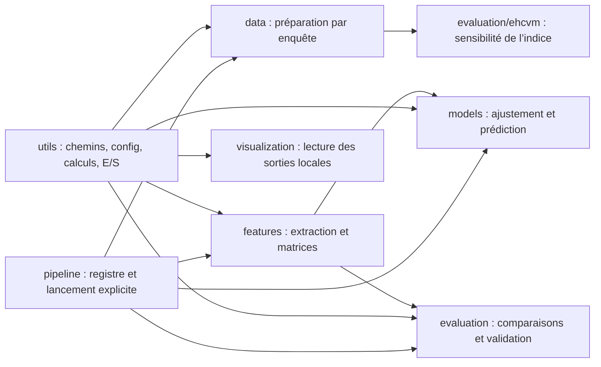

# Architecture et décisions de conception

## Organisation

Le code est organisé par responsabilités : préparation des sources, extraction des caractéristiques, modélisation, évaluation et visualisation. Les sous-dossiers DHS et EHCVM portent les spécificités des enquêtes ; les étapes communes partagent le protocole de comparaison.

Le registre `src/pipeline.py` décrit les étapes exécutables et leurs entrées attendues. Chaque étape est lancée explicitement ; le registre ne réalise pas un enchaînement automatique des dépendances.

## Sens des dépendances

Les flèches représentent les relations entre les composants. `utils` ne dépend pas des étapes ; les modèles n’importent pas les points d’entrée d’évaluation. L’assemblage des matrices réside dans `src/features/design.py`. Les opérations numériques de l’indice sont dans `src/utils/wealth.py` ; les recodages EHCVM partagés sont dans `src/data/ehcvm/wealth_index.py`.

## Contrats d’exécution

- Chaque étape enregistrée expose `main()` et s’exécute uniquement sur appel explicite.
- Les étapes historiques encapsulent leur exécution dans `main()`. Leurs classes de jeux de données utilisent `num_workers=0` ; une mise en parallèle nécessite leur extraction au niveau du module.
- Un test importe toutes les étapes avec interdiction d’écriture et de connexion réseau, après initialisation des bibliothèques tierces.
- Les chemins locaux ne dépendent pas du répertoire de lancement.
- La lecture des tables vérifie les clés requises, leur unicité et l’absence de clés manquantes.
- Les partitions de validation doivent avoir des groupes disjoints et tester chaque observation exactement une fois.

## Configuration et séparation des fichiers

La configuration scientifique publique est `config/config.yaml`. Un YAML externe peut surcharger certaines valeurs via `RICHESSE_CONFIG_FILE` ; les clés inconnues sont refusées. `EE_PROJECT_ID` surcharge le projet Earth Engine.

`RICHESSE_DATA_DIR` désigne un dossier de données externe. `RICHESSE_OUTPUTS_DIR` désigne un dossier de sorties externe. Les définir avant de lancer Python ; les chemins sont résolus au chargement du processus. Les sources brutes doivent rester en lecture seule. Ne pas utiliser le même dossier pour les données et les sorties.

Les données, sorties et fichiers Word sont exclus du dépôt. Le contrôle de publication refuse les chemins non autorisés et recherche certains contenus sensibles dans le dossier de travail et l’index Git. Il ne remplace pas une revue humaine.

## Limites techniques

Les scripts historiques restent longs et contiennent des paramètres en dur. Leur isolation supprime les calculs à l’import ; elle ne constitue pas une refonte complète en petites fonctions testables. Les nouvelles comparaisons doivent utiliser le noyau partagé et les étapes communes. Les anciennes variantes restent utiles pour tracer les expériences, avec leur statut exploratoire.

Le paquet Python est utilisé depuis la racine avec `python run_pipeline.py` ; le projet n’est pas présenté comme une bibliothèque installable par `pip install .`. Les dépendances sont installées via le fichier de versions vérifié. Un passage ultérieur à un paquet distribué exigerait une configuration de packaging et des tests dédiés.

Le pipeline ne fournit pas encore une traçabilité complète par empreintes des entrées, de tous les paramètres et des poids CNN. Il faut donc conserver les versions de configuration et les sorties d’exécution dans l’espace de recherche privé. Les reprises d’extraction ne doivent pas mélanger des caractéristiques produites avec des paramètres ou des poids différents.
